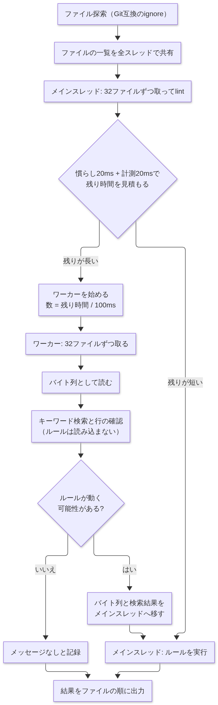

ソースコードや設定ファイルに含まれるAPIトークンやパスワードなどの機密情報を見つける[Secretlint](https://github.com/secretlint/secretlint)のv14.0.0をリリースしました。

- [Release v14.0.0 · secretlint/secretlint](https://github.com/secretlint/secretlint/releases/tag/v14.0.0)

このバージョンの主な変更点は次の2つです。

- 設定ファイルなしで動作（公式ルールとプリセットを`secretlint`本体に同梱）
- ファイル数が多いリポジトリでのチェックを高速化

v13からv14へは、基本的に設定や使い方を変えなくてもアップデートできます。
公式ルールが本体に入ったので、不要になったルールのパッケージを取り除くことを推奨します。
詳しくは移行ガイドを参照してください。

- [v13からv14への移行ガイド](https://github.com/secretlint/secretlint/blob/HEAD/docs/migrations/v13-to-v14.md)

この記事では、次の3つを順番に書きます。

- v14の変更点と、設定なしで動作する仕組み
- どういう考え方でパフォーマンスを改善したか
- 最終的な処理の流れと技術的な詳細

## v14の変更点

詳しい変更点は、リリースノートと移行ガイドを参照してください。
ここでは主な変更点を紹介します。

### 設定なしで動作

v14では、事前のインストールや設定ファイルなしで、次のコマンドだけで動きます。

```bash
npx secretlint "**/*"
```

設定ファイルがないときは、エラーで終わる代わりにrecommendプリセットで実行します（[#1835](https://github.com/secretlint/secretlint/pull/1835)）。
v13までは、`secretlint`とは別にルールのパッケージをインストールして、`.secretlintrc.json`にそのルールを書く必要がありました。

### 仕組み: 公式ルールを本体に同梱

設定なしで動作するのは、公式ルールとプリセットを`@secretlint/core`へ含めたためです（[#1798](https://github.com/secretlint/secretlint/pull/1798), [#1832](https://github.com/secretlint/secretlint/pull/1832)）。
recommendプリセットが本体に入り、パッケージとして1つとなったため、`.secretlintrc.json`の設定ファイルを必須にする理由がなくなりました。
インストールも`secretlint`だけで済みます。

```bash
# v13
npm install secretlint @secretlint/secretlint-rule-preset-recommend --save-dev
# v14
npm install secretlint --save-dev
```

ルールのidは変わらないため、今の`.secretlintrc.json`はそのまま動きます。
本体に同梱された公式ルールのパッケージ（例: `@secretlint/secretlint-rule-preset-recommend`）は、もう更新されません。
そのため、`package.json`から削除できます。
Secretlint v14を使う場合は、不要になったパッケージを次のコマンドで削除してください。

```bash
npm uninstall @secretlint/secretlint-rule-preset-recommend
```

ほかの公式ルールのパッケージを入れている場合のコマンドは、[移行ガイド](https://github.com/secretlint/secretlint/blob/HEAD/docs/migrations/v13-to-v14.md)に書いています。

あわせて、`secretlint`のサードパーティの実行時依存は69パッケージから16パッケージに減りました。

### 同梱した理由

同梱した主な理由は、npmへのパッケージ公開がボトルネックになり、新しいルールを追加するコストが高くなっていたためです。
v13までは、公式ルールが1つずつ別のnpmパッケージでした。
新しいルールを追加するには、新しいnpmパッケージを作る必要があります。

近年のサプライチェーン攻撃への対策として、npmパッケージを公開するときの工程は増えています。
SecretlintはOIDCを使うTrusted Publishingでパッケージを公開していますが、新しいパッケージは`npm publish`だけでは作れません。
Trusted Publishingは、一度公開されたパッケージにしか設定できないためです。
そのため、まず設定用の空のパッケージを公開し、Trusted Publishingを設定してから、本来のパッケージを公開するという2段階の流れになります。
この流れについては、次の記事に書いています。

- [npm Trusted PublishingでOIDCを使ってトークンレスでCIからnpmパッケージを公開する](https://efcl.info/2025/09/07/npm-oidc/)

この2段階の流れは、[setup-npm-trusted-publish](https://github.com/azu/setup-npm-trusted-publish)というツールを書いて、対話的に進められるようにしています。
`npm login`、設定用のパッケージの公開、Trusted Publishingの設定、`npm logout`までを順番に実行できます。

<blockquote class="twitter-tweet"><p lang="ja" dir="ltr">setup-npm-trusted-publishにinteractive modeを追加しました。<br>これでポチポチするだけで、npm loginしてplaceholder packageをpublishして、Trusted Publishingの設定をして、npm logoutするというのができる。<a href="https://t.co/954kn24lfP">https://t.co/954kn24lfP</a> <a href="https://t.co/vZnWZHLgOB">pic.twitter.com/vZnWZHLgOB</a></p>&mdash; azu (@azu_re) <a href="https://x.com/azu_re/status/2121972456806346757?ref_src=twsrc%5Etfw">November 15, 2026</a></blockquote>
<script async src="https://platform.x.com/widgets.js" charset="utf-8"></script>

それでも、新しいパッケージを作るたびにローカルでの作業が増えることは変わりません。
この手間があるため、新しいルールを気軽に追加できなくなっていました。
v14からは、新しいルールは`@secretlint/core`の中のファイルとして追加します。
新しいnpmパッケージを作る必要がなく、ルールのバージョンは常にSecretlint本体と同じです。

### 宣言的なルール

ルールを、`create()`関数ではなく`keywords`付きの`patterns`で宣言的に書けるようになりました（[#1794](https://github.com/secretlint/secretlint/pull/1794)）。
`@secretlint/secretlint-rule-pattern`に書いた独自のパターンも、同じ仕組みで動きます（[#1826](https://github.com/secretlint/secretlint/pull/1826)）。
これは、次に書くパフォーマンス改善の土台になっています。

### 破壊的変更

多くの利用者は、何も変えずにアップデートできます。
主な破壊的変更は次のとおりです。

- 結果と`--format json`から`sourceContent`を削除し、フォーマッターには`getSource(filePath)`を渡す（[#1797](https://github.com/secretlint/secretlint/pull/1797)）
- `--secretlintignore`はカレントディレクトリからのパスとして読み、`.secretlintignore`に加えて使う（[#1834](https://github.com/secretlint/secretlint/pull/1834)）
- ファイルをlintする順序は保証せず、ファイルをまたいで状態を持つルールはサポートしない
- `--profile`は、lintの結果の代わりにサマリーを出力

v14がサポートするのは、Node.js 22+です。

## パフォーマンス改善の進め方

約10万ファイルある[torvalds/linux](https://github.com/torvalds/linux)リポジトリ全体のチェックは、v13.1.0では42.1秒かかっていました。
v14では1.74秒です。
RustなどのネイティブコードやWebAssemblyは使わず、Secretlintは今もJavaScriptだけで動いています。


| 対象のリポジトリ | ファイル数 | v13.1.0 | v14 | 速度比 |
| --- | ---: | ---: | ---: | ---: |
| 1ファイル（pre-commitフックのような使い方） | 1 | 191 ms | 105 ms | 1.8倍 |
| [facebook/react](https://github.com/facebook/react) | 7,275 | 2.18 s | 274 ms | 7.9倍 |
| [microsoft/vscode](https://github.com/microsoft/vscode) | 21,444 | 11.0 s | 634 ms | 17.4倍 |
| [torvalds/linux](https://github.com/torvalds/linux) | 97,265 | 42.1 s | 1.74 s | 24.2倍 |

`secretlint "**/*"`をrecommendプリセットで実行した時間の中央値で、Node.js 24.22、4 vCPUのLinuxで計測した結果です。
CPUのコア数が多いマシンではもっと並列化されるので、ファイル数が多いリポジトリでの改善率はもう少し良くなるはずです。

まず1スレッドのネイティブ実装とJavaScriptの実装を比べて、その差を埋めました。
1スレッドでほぼ同じ速さになれば、残る差は並列化だけです。
その並列化は、ルールを読み込まない軽いワーカースレッドで、キーワードを探す処理だけに入れました。

進めた順番は次のとおりです。

1. `--profile`とCIで、どこに時間がかかるかを計測できる状態にする
2. 同じ処理をRustで書き、1スレッドのネイティブ実装とJavaScriptの実装を比較
3. 1スレッドでの差（ファイル探索、起動、文字列への変換）を解消
4. 残った差である並列化の方法を比較
5. ワーカースレッドで、ファイルの読み込みとキーワード検索だけを並列化
6. Worker数を、ファイル数ではなく処理時間から算出
7. 短いキーワードには後ろに続く文字の条件を付けて、ルールを実行する量を削減

### 計測できる状態にする

最初に、`secretlint --profile`でフェーズ、ルール、パターン、ファイルごとの時間を出せるようにしました（[#1820](https://github.com/secretlint/secretlint/pull/1820)）。
PRごとにbaseとheadのプロファイルとベンチマークを比べるCIも入れています（[#1828](https://github.com/secretlint/secretlint/pull/1828)）。
これで、改善と劣化がPRの時点で見えます。

たとえば、約2万ファイルある[microsoft/vscode](https://github.com/microsoft/vscode)リポジトリで`secretlint --profile "**/*"`を実行すると、次のような出力になります。
フェーズ、スレッド、ルール、パターン、ファイルごとの時間が出ます。
パターンの正規表現は、途中で省略しています。

```
secretlint profile: 798.45ms, 21442 files

Phase                                Time(ms)      %  Count
secretlint>cli                         798.45  100.0      1
  @node>load-config                      8.39    1.1      1
    @config-loader>load-config-file      6.95    0.9      1
    @config-loader>load-packages         1.26    0.2      1
  secretlint>search-files              110.96   13.9      1
  @node>execute                        678.51   85.0      1
    @node>read-file                    156.44   19.6   5024
    @core>lint                         364.49   45.6   5346
      @core>setup-rules                  2.93    0.4      1
      @core>keyword-scan               267.79   33.5   5057
      @core>line-check                  23.41    2.9    877
      @core>rule-handler                19.76    2.5   2498
    @node>format                        25.45    3.2      1

Time(ms)  Files  Thread (4)
  627.45   5024  main
  499.42   4544  worker 1
  507.85   6400  worker 2
  477.69   5474  worker 3

Time(ms)  Files  Rule (top 10 of 28)
    5.61     84  @secretlint/secretlint-rule-basicauth
    3.14     84  @secretlint/secretlint-rule-github
    2.49     84  @secretlint/secretlint-rule-notion
    1.68      2  @secretlint/secretlint-rule-filter-comments
    1.64     84  @secretlint/secretlint-rule-npm
    1.31     84  @secretlint/secretlint-rule-privatekey
    1.16     84  @secretlint/secretlint-rule-aws
    0.82     84  @secretlint/secretlint-rule-database-connection-string
    0.61     84  @secretlint/secretlint-rule-huggingface
    0.42     84  @secretlint/secretlint-rule-databricks

Time(ms)  Run(ms)  Runs  Matches  LineTest(ms)  LineTests  Pattern (top 10 of 16)
   19.18     5.06  2006       48         14.13      18087  @secretlint/secretlint-rule-basicauth#0 /(?<protocol>(?:https?|ftp|ftps)):.../
   11.62     0.00     0        0         11.62        713  @secretlint/secretlint-rule-sendgrid#0 /(?<!\p{L})SG\.\w{1,128}\.\w{1,128}.../gu
    3.13     0.37     9        0          2.76       1509  @secretlint/secretlint-rule-databricks#0 /(?<!\p{L})dapi[A-Fa-f0-9]{32}.../gu
    2.78     1.10     5        2          1.67        391  @secretlint/secretlint-rule-npm#2 /(?<!\p{L})npm_[A-Za-z0-9_]{36}.../gu
    2.47     1.60     2        1          0.88          7  @secretlint/secretlint-rule-github#1 /(?<!\p{L})(?<type>github_pat)_.../gu

Time(ms)  File (top 10 of 21442)
   11.46  <cwd>/extensions/copilot/test/prompts/fixtures/devcontainer/devContainerIndex.json
    8.19  <cwd>/src/vs/platform/agentHost/node/copilot/copilotAgentSession.ts
    7.84  <cwd>/src/vs/platform/agentHost/test/node/protocolServerHandler.test.ts
```

この出力から、次のことが読み取れます。

- 21,442ファイルを、メインスレッドと3つのワーカーが分担して処理
- いちばん時間を使っているのはキーワード検索（`@core>keyword-scan`）と、ファイルの読み込み（`@node>read-file`）
- ルールの実行（`@core>rule-handler`）は19.76msで、ルールが動いたのは84ファイルだけ

### 1スレッドのネイティブ実装とJSの実装を比較

次に、同じ処理をRustで書いて、1スレッドの時間を比べました。
比べたのは、ファイル探索、読み込み、キーワード検索の3つです。
ファイル探索にはripgrepが使っている[ignore crate](https://docs.rs/ignore/latest/ignore/)、キーワード検索には[aho-corasick crate](https://docs.rs/aho-corasick/latest/aho_corasick/)を使っています。

microsoft/vscodeリポジトリでは、ファイルの読み込みはRustが275〜290ms、Secretlintが約270msでほぼ同じでした。
同じ66個のキーワードを探す時間も、どちらも約660msでした。
差があったのはファイル探索で、ignore crateの50〜55msに対してSecretlintは約180msでした。
ほかの差は、起動やGCなどJavaScriptのランタイムにかかる時間です。

つまり、読み込みと検索そのものはJavaScriptでもネイティブとほぼ同じ速さでした。

正規表現は、V8の正規表現エンジンをそのまま使っています。
正規表現が動くのはキーワードで絞り込んだあとだけなので、全体の中では小さな時間でした。

### 1スレッドでの差を埋める

ファイル探索では、Gitと同じ挙動のignoreのマッチャーを自前で実装しました。
ignoreのパターンは、ファイルやディレクトリの名前と拡張子をキーにした表から引きます。
すべてのパターンを順番に試す必要がなくなりました（[#1818](https://github.com/secretlint/secretlint/pull/1818), [#1822](https://github.com/secretlint/secretlint/pull/1822)）。
microsoft/vscodeリポジトリのファイル探索は158msから53msになり、ignore crateの1スレッド（32〜36ms）に近づいています。

検索では、[Yuku](https://yuku.fyi/)などを参考にして、data-oriented design（データ指向設計）の考え方を使いました。
Yukuのパーサーは、ノードごとにオブジェクトを作らず、1つの配列とその中の位置（インデックス）でASTを表します。
文字列もソースの中の位置として持ち、必要になるまで取り出しません。

- [Data-Oriented Design in Yuku's Parser - Arshad Yaseen](https://www.arshad.fyi/posts/yuku-parser.html)

Secretlintでも同じように、最初の段階ではファイルごとのオブジェクトや文字列を作りません。
ルールを宣言的なデータにして、ファイルのバイト列を1回だけ走査し、すべてのルールのキーワードをまとめて探します（[#1794](https://github.com/secretlint/secretlint/pull/1794)）。
この走査で記録するのは、キーワードがあった位置だけです。
文字列に変換するのは、キーワードがあった行だけです。
キーワードがないファイルは文字列に変換せず、ルールも動かしません。

こうすると、ファイルごとに行うデータの変換とメモリの確保が減ります。
たとえば14,430ファイルを`utf8`の文字列として読むと614msかかります。
1つの`Buffer`を使い回して、`fs.readSync`でバイト列として読むと82msで済みました。
v14の実装も、`Buffer.allocUnsafe`で確保した1つの`Buffer`を使い回しています。
ワーカーからメインスレッドへは、`Uint8Array`にまとめたバイト列をコピーせずにtransferしています。

起動も、依存を減らすことと、フォーマッターの読み込みや初期化を必要になるまで遅らせることで短くしています（[#1813](https://github.com/secretlint/secretlint/pull/1813), [#1814](https://github.com/secretlint/secretlint/pull/1814), [#1816](https://github.com/secretlint/secretlint/pull/1816)）。

ここまでの改善で、ワーカースレッドを使わない1スレッドの状態でも、次の速さになりました。

| 対象のリポジトリ | ファイル数 | v13.1.0 | v14（1スレッド） | v14 |
| --- | ---: | ---: | ---: | ---: |
| facebook/react | 7,275 | 2.18 s | 332 ms | 274 ms |
| microsoft/vscode | 21,444 | 11.0 s | 1.05 s | 634 ms |
| torvalds/linux | 97,265 | 42.1 s | 4.26 s | 1.74 s |

冒頭の表と同じ計測で、v13.1.0とv14の値は同じものです。
「v14（1スレッド）」は、v14.0.0でワーカースレッドを起動しないようにして計測した値です。

torvalds/linuxリポジトリでは、1スレッドのままでも42.1秒が4.26秒になりました。
シングルスレッドの改善がある程度できたところで、次はファイル数が多いときの並列化の方法を考えていきました。

### 並列化の方法を選ぶ

Rustのignore crateでの探索やaho-corasick crateでの検索と、1スレッドではほぼ同じ速さになりました。
残るネイティブの実装との差は、スレッドの数の分だけです。
並列化の方法として、ネイティブのプログラム、WebAssembly、Node.jsのワーカースレッドを比べました。

キーワードの絞り込みをRustの子プロセスで並列に行うプロトタイプでは、4スレッドでの読み込みと検索は207msでした。
同じことをするJavaScriptのワーカースレッド4つは241msで、ほぼ同じです。
ネイティブにするとプラットフォームごとのビルドと配布が必要です。
それで得られるのがワーカースレッドと同じ並列化の分だけなので、ワーカースレッドを選びました。

並列化するのはNode.jsのエンジン（`@secretlint/node`）とCLIのレイヤーだけです。
`@secretlint/core`はブラウザでも動かすので、コアの中でスレッドの開始を扱うのは複雑になりそうでした。
そのため、ワーカースレッドを起動するのは`@secretlint/node`の役割にしています。
`@secretlint/core`には、キーワード検索だけを呼び出せるモジュールを用意しました。

### JavaScriptのままにした理由

JavaScriptのままにすること自体へのこだわりは、そこまでありませんでした。
測ってみるとJavaScriptのままでも十分速くなったので、別の言語にする理由はなくなったという形です。

一方で、ブラウザでもSecretlintを動かしたいという要件はあります。
`@secretlint/core`とrecommendプリセットはブラウザでそのまま動き、PlaywrightとChromiumでのテストを変更ごとに実行しています（[#1803](https://github.com/secretlint/secretlint/pull/1803)）。
Wasmやネイティブのバイナリにすると、ブラウザで動かすのが面倒です。
たとえば、[es-module-lexer](https://www.npmjs.com/package/es-module-lexer)はWasmのモジュールをBase64にしてJavaScriptに埋め込んでいます（[コード](https://www.npmjs.com/package/es-module-lexer?activeTab=code)）。
小さなWasmならまだ埋め込めますが、コア自体をネイティブの言語で実装すると、もっと面倒になります。

もう1つの理由は、ルールの性質です。
Secretlintのルールを整理すると、ほとんどは「キーワード」と「正規表現」で書ける宣言的なルールでした。
調べた時点では、recommendプリセットの28ルールのうち27ルールがこの形で書けました。

Parcel 3のように、coreをネイティブで書き直す構成も考えられます。
Parcel 3はRustで全体を書き直していて、プラグインもRustなどのネイティブの言語で書くようになっています。
（AIでコードを書くので、以前よりプラグインをJavaScriptにする理由は減ってきていそうです）

- [Announcing Parcel 3 alpha](https://v3.parceljs.org/blog/v3-alpha/)

ただ、ネイティブとJavaScriptを混ぜると、その間でデータを渡すシリアライズのコストがかかります。
Parcel 3の記事も、JavaScriptのcoreの限界として、ワーカーや言語の間で値をシリアライズするコストを挙げています。
Secretlintのルールはほとんどが宣言的なデータなので、あえてネイティブとJavaScriptを混ぜる必要性がありませんでした。
先に書いたように大きなコストは読み込みとデータの変換なので、混ぜると変換が増えて逆に遅くなりえます。
ルールが宣言的なデータであれば、JavaScriptのままでも実行の仕方をcoreの側で最適化できます。

### ルールをワーカーで動かさない理由

プロファイルを見ると、時間を使っていたのはキーワード検索とファイルの読み込みでした。
次の表は、ワーカースレッドを入れる前に[torvalds/linux](https://github.com/torvalds/linux)リポジトリで取ったプロファイルです。

| 処理 | 時間 | 全体に占める割合 |
| --- | ---: | ---: |
| キーワード検索 | 2,927 ms | 約66% |
| ファイルの読み込み | 838 ms | 約19% |
| そのほか（ファイル探索、ルールの実行など） | 694 ms | 約16% |
| 全体 | 4,459 ms | 100% |

ルールの実行には、あまり時間がかかっていません。
ルールが動くのは、キーワードで絞り込んだファイルだけだからです。

そこで、ワーカースレッドではファイルを読んでキーワードを探すところだけを行い、ルールはメインスレッドで実行します（[#1824](https://github.com/secretlint/secretlint/pull/1824)）。

ルールまでワーカーで実行すると、各ワーカーが起動のたびに設定とすべてのルールを読み込みます。
読み込むモジュールの大きさは、設定に書かれたルールによって変わります。
特にカスタムルールとその依存は、どれだけ大きいかがSecretlintからは分かりません。
そのため、ワーカーの起動にかかる時間が設定ごとに変わり、ワーカーを増やすと速くなるかを見積もれません。


ESLintはv9.34.0でマルチスレッドのlintを入れています。
その紹介記事には、スレッドを増やすとかえって遅くなる場合があると書かれています。
設定やプラグインの初期化が長い場合です。

- [New in ESLint v9.34.0: Multithread Linting](https://eslint.org/blog/2025/08/multithread-linting/)

textlintでも、v11.4.0で`--parallel`を実験的に入れたことがあります（[textlint#633](https://github.com/textlint/textlint/issues/633)）。
ファイル数がとても多いと効果が出ますが、ワーカーの起動が重く、そこまで効果は出ませんでした。
後のバージョンで、この`--parallel`はdeprecatedとなりました（[textlint#1383](https://github.com/textlint/textlint/pull/1383)）。

Secretlint v14では、ワーカースレッドでルールを実行していません。
ワーカースレッドが行うのは、ファイルの読み込み、キーワード検索、キーワードのある行の確認だけです。
そのために必要なキーワードの文字列と、行を確かめる正規表現のソースとフラグは、メインスレッドからデータとして受け取ります。
ワーカースレッドが読み込むコードはキーワード検索の部分だけなので、ルールが増えても起動時間は変わりません。

### Worker数を処理時間から算出する

ワーカーを始めるかどうかとその数は、ファイル数ではなく処理時間から算出しています。
まずメインスレッドだけでlintを始めて、1ファイルあたりにかかった時間を測ります。
その時間にまだ処理していないファイルの数を掛けて、残りのファイルをメインスレッドだけで処理し終えるまでの時間を見積もります。
この見積もりがワーカー1つの起動にかかる時間（約100ms）より短ければ、ワーカーを1つも始めません。
長ければ、見積もった時間の100msごとにワーカーを1つ始めます。
そのため、小さなリポジトリやpre-commitでの実行が、ワーカーの起動コストを払うことはありません。

走査の時間はファイルの大きさやディスクの速さで変わります。
ファイル数を定数で割る方法だと、あるリポジトリに合う定数が別のリポジトリには合いません。

### ルールを実行する量を減らす

ルールを実行するメインスレッドは1つです。
そのため、ルールへ来る前の段階でファイルを減らす実装をしています。
ルールが動くのは、キーワードがあり、さらにその行がパターンの正規表現に一致したファイルだけです。

Secretlintは誤検知（false positive）を減らす方針なので、基本的には形式が決まっているcredentialだけを検出します。
一方で、接頭辞の形式は決まっていても、Oktaのトークンの`00`のように、短くてほかの場所にも登場する接頭辞を使うサービスがあります。
こういう接頭辞は多くのファイルに当たるので、キーワードとして役に立ちません。
その対策として、キーワードの後ろに続く文字の種類と数を、バックトラックがない正規表現のミニサブセットのような表現で書けるようにしました（[#1827](https://github.com/secretlint/secretlint/pull/1827)）。

```js
keywords: ["sk-ant-", { keyword: "00", after: "[A-Za-z0-9_-]{40,}" }]
```

この例では、`after`に書いたとおり、`00`の後ろに指定した文字が40文字以上続く場所だけが、キーワードとして扱われます。
この条件はキーワード検索のループの中で確かめるので、条件を満たさない場所は記録もしません。
書けるものを文字の集合と数だけに限っているのは、バックトラックがなく、コストの上限が決まるためです。

### 試して直したこと

ワーカーの最初の版は、先に全ファイルを走査して、キーワードのあるファイルをメインスレッドが読み直す作りでした。
この作りは、キーワードを持たないルールがある設定で、すべてのファイルを2回読んでしまいます。
macOSではファイルの読み込みが1ファイルあたり約96µsと重く、1スレッドより遅くなりました。
そのため、ファイルを読むのは1回だけにして、ワーカーが読んだバイト列をメインスレッドへ渡す設計に直しています。

## 最終的な処理の流れ

v14の`secretlint "**/*"`は、次のように動きます。



この流れのポイントは次のとおりです。

- 最初はメインスレッドだけで始め、残りに時間がかかりそうなときだけワーカーを起動
- メインスレッドはワーカーから渡されたファイルのルール実行を優先し、空いていれば自分でも絞り込みに参加
- ファイルを読むのは、そのファイルを取ったスレッドの1回だけ
- メッセージを作るのはメインスレッドのルールだけなので、結果は1スレッドのときと同じ
- ワーカーはルールを読み込まないので、起動は小さく一定
- `@secretlint/core`はワーカーを始めず、並列化するのはNode.jsのエンジン、CLI、単一実行バイナリのレイヤーだけ

ファイル数が少ないときは、残りの処理がすぐ終わると見積もられるので、ワーカーを1つも起動しません。
そのため、pre-commitフックで数ファイルだけをチェックするような使い方では、ワーカーの起動コストがSecretlintの実行時間に加わりません。
今回の計測でも、1ファイルのチェックは、ワーカーを起動しないようにした場合が109 ms、既定のままが105 msで、差はありませんでした。

## 技術的な詳細

この辺の設計は、[sdev](https://github.com/azu/sdev)で仕様を詰めながら実装しています。
ワーカースレッドの設計は、リポジトリの設計ドキュメントにまとめています。

- [secret-scanningの設計ドキュメント（Looking for keywords on several threads）](https://github.com/secretlint/secretlint/blob/HEAD/docs/products/secretlint/features/secret-scanning/design.md)

ワーカースレッドが読み込むのは、`@secretlint/core/keyword-scan`というキーワード検索だけのモジュールです。
このモジュールは、ルールや設定を読み込みません。
メインスレッドは、設定からキーワードと行を確かめる正規表現を取り出して、ワーカースレッドへデータとして渡します。

メインスレッドとワーカーは、ファイルの一覧と`SharedArrayBuffer`を共有し、`Atomics.add`で次の32ファイルを取ります。
ファイルを前もってスレッドに割り当てないので、遅れて始まったスレッドは受け持つファイルが少なくなるだけです。

ワーカーは、キーワードのある行だけを文字列にして、パターンの正規表現でテストします。
キーワードのあるファイルは、パターンに一致するファイルよりずっと多くあります。
この確認をメインスレッドでやると、メインスレッドが限界になりました。

ワーカーの数は、次のように決めています。
メインスレッドは20msの慣らしのあと、次の20msでlintできたファイル数から、1ファイルあたりの時間を出します。
残りのファイルを処理し終えるまでの見積もりは、`1ファイルあたりの時間 × まだ処理していないファイルの数`です。
始めるワーカーの数は`floor(見積もった時間 / 100ms)`で、多くても`os.availableParallelism() - 1`です。
100msは、ワーカーの起動にかかるおおよその時間です。
慣らしを入れているのは、ランタイムが最適化するまでlintが数倍遅く、見積もりが大きくなりすぎるためです。

メモリには上限があります。
メインスレッドがまだlintしていないバイト列が256MBを超えている間、ワーカーは次のファイルを取らずに待ちます。

Bunの`bun build --compile`で作る単一実行バイナリには、ワーカーを2つ目のエントリーとして同梱しています。
そのため、バイナリでも同じ仕組みで動きます。

## 書いてみて思ったこと

自分で実装してみると、ほかのツールと大体同じことをやっていました。

[Hyperscan](https://www.usenix.org/conference/nsdi19/presentation/wang-xiang)は、正規表現から固定の文字列を取り出して先に探し、見つかった場所だけで正規表現を確かめます。
Secretlintの、キーワードで絞り込んでから正規表現を動かす流れと同じ考え方です。

[Betterleaks](https://github.com/betterleaks/betterleaks)は、Aho-Corasickによるキーワードの絞り込みと並列化を、速さの理由として挙げています。
キーワードの後ろの文字が満たすべき条件を確かめる仕組み（[assignment_guard.go](https://github.com/betterleaks/betterleaks/blob/main/scan/assignment_guard.go)）も持っています。
Betterleaksはこの条件を正規表現から推測します。
Secretlintは、ルールを書く人が条件を明示的に書き、書き間違いはテストで落とします。

ripgrepも、ignore crateで探索したファイルを複数のスレッドで検索します。

最初からこれらを真似したわけではありません。
計測してボトルネックを1つずつ潰していくと、結果として似た形になりました。
みんな大体同じようなことをやっているんだな、と書いていて思いました。

## まとめ

[Secretlint v14.0.0](https://github.com/secretlint/secretlint/releases/tag/v14.0.0)では、公式ルールを本体に同梱し、JavaScriptのままファイル数が多いリポジトリでのチェックを速くしました。

- [v13からv14への移行ガイド](https://github.com/secretlint/secretlint/blob/HEAD/docs/migrations/v13-to-v14.md)

ぜひ`npx secretlint "**/*"`で試してみてください。
