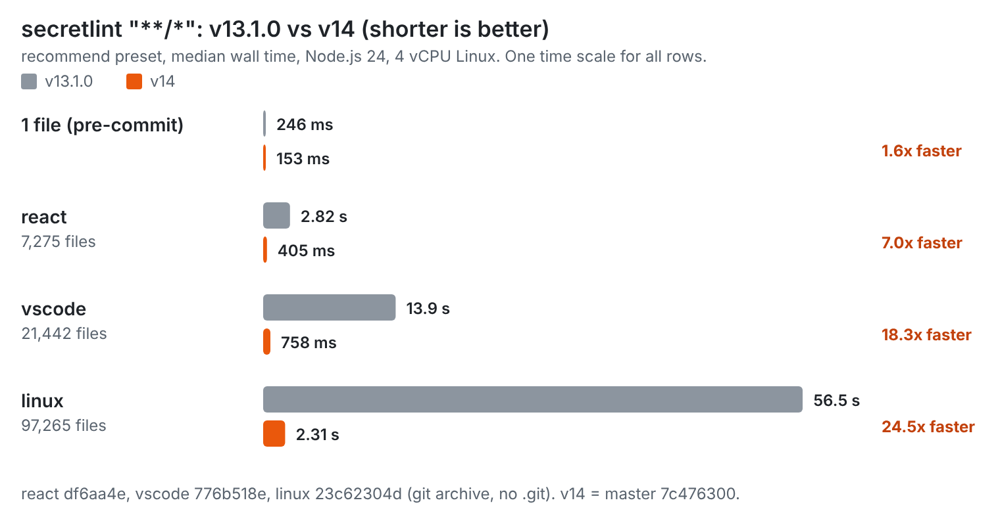

ソースコードや設定ファイルに含まれるAPIトークンやパスワードなどの機密情報を見つける[Secretlint](https://github.com/secretlint/secretlint)のv14.0.0をリリースしました。

- [Release v14.0.0 · secretlint/secretlint](https://github.com/secretlint/secretlint/releases/tag/v14.0.0)

このバージョンの主な変更点は次の3つです。

- 公式ルールとプリセットを`secretlint`本体に同梱
- 設定ファイルがないときは、recommendプリセットで実行
- 約10万ファイルあるリポジトリ全体のチェックが約2秒で終わるように高速化

v13からのアップデート方法は、移行ガイドにまとめています。

- [v13からv14への移行ガイド](https://github.com/secretlint/secretlint/blob/HEAD/docs/migrations/v13-to-v14.md)

速さについては、約10万ファイルあるlinuxのリポジトリ全体のチェックが、v13.1.0の56.5秒から2.31秒になりました。
RustなどのネイティブコードやWebAssemblyは使わず、Secretlintは今もJavaScriptだけで動いています。

この記事では、どういう考え方でパフォーマンスを改善したかを主に書きます。
後半で、リリースノートの要約と技術的な詳細を紹介します。



| `secretlint "**/*"` | ファイル数 | v13.1.0 | v14 | |
| --- | ---: | ---: | ---: | ---: |
| 1ファイル（pre-commitフックのような使い方） | 1 | 246 ms | 153 ms | 1.6倍 |
| [react](https://github.com/facebook/react) | 7,275 | 2.82 s | 405 ms | 7.0倍 |
| [vscode](https://github.com/microsoft/vscode) | 21,442 | 13.9 s | 758 ms | 18.3倍 |
| [linux](https://github.com/torvalds/linux) | 97,265 | 56.5 s | 2.31 s | 24.5倍 |

recommendプリセット、実行時間の中央値、Node.js 24.22、4 vCPUのLinuxで計測した結果です。
vscodeでは、どちらのバージョンも同じ37件を報告します。

## パフォーマンス改善の進め方

まずネイティブの実装と1スレッド同士で比べて、その差を埋めました。
1スレッドでほぼ同じ速さになれば、残る差は並列化だけです。
その並列化は、ルールを読み込まない軽いワーカースレッドで、キーワードを探す処理だけに入れました。

進めた順番は次のとおりです。

1. `--profile`とCIで、どこに時間がかかるかを計測できる状態にする
2. 同じ処理をRustで書き、1スレッド同士で比較
3. 1スレッドでの差（ファイル探索、起動、文字列への変換）を解消
4. 残った差である並列化の方法を比較
5. ワーカースレッドで、ファイルの読み込みとキーワード検索だけを並列化
6. ワーカーの数を、ファイル数ではなく計測した時間から決定
7. ガード付きキーワードで、メインスレッドのルールまで届くファイルを削減

### 計測できる状態にする

最初に、`secretlint --profile`でフェーズ、ルール、パターン、ファイルごとの時間を出せるようにしました（[#1820](https://github.com/secretlint/secretlint/pull/1820)）。
PRごとにbaseとheadのプロファイルとベンチマークを比べるCIも入れています（[#1828](https://github.com/secretlint/secretlint/pull/1828)）。
これで、改善と劣化がPRの時点で見えます。

### ネイティブの実装と1スレッドで比べる

次に、同じ処理をRustで書いて、1スレッドの時間を比べました。
比べたのは、ファイル探索、読み込み、キーワード検索の3つです。
ファイル探索にはripgrepが使っている[ignore crate](https://docs.rs/ignore/latest/ignore/)、キーワード検索には[aho-corasick crate](https://docs.rs/aho-corasick/latest/aho_corasick/)を使っています。

vscodeのリポジトリでは、ファイルの読み込みはRustが275〜290ms、Secretlintが約270msでほぼ同じでした。
同じ66個のキーワードを探す時間も、どちらも約660msでした。
差があったのはファイル探索で、ignore crateの50〜55msに対してSecretlintは約180msでした。
ほかの差は、起動やGCなどJavaScriptのランタイムにかかる時間です。

つまり、読み込みと検索そのものはJavaScriptでもネイティブとほぼ同じ速さでした。

### 1スレッドでの差を埋める

ファイル探索では、Gitと同じ挙動のignoreのマッチャーを自前で実装しました。
ignoreのルールは、エントリーの名前から引きます（[#1818](https://github.com/secretlint/secretlint/pull/1818), [#1822](https://github.com/secretlint/secretlint/pull/1822)）。
vscodeのファイル探索は158msから53msになり、ignore crateの1スレッド（32〜36ms）に近づいています。

検索は、データの形から考え直しました。
ルールを宣言的なデータにして、ファイルのバイト列を1回だけ走査し、すべてのルールのキーワードをまとめて探します（[#1794](https://github.com/secretlint/secretlint/pull/1794)）。
キーワードがないファイルは文字列に変換せず、ルールも動かしません。

データ指向で見ると、大きなコストはファイルの読み込みとデータの変換でした。
たとえば14,430ファイルを`utf8`の文字列として読むと614msかかります。
使い回すバッファにバイト列として読むと82msで済みました。

起動も、依存を減らすことで短くしています（[#1813](https://github.com/secretlint/secretlint/pull/1813), [#1814](https://github.com/secretlint/secretlint/pull/1814), [#1816](https://github.com/secretlint/secretlint/pull/1816)）。

### 並列化の方法を選ぶ

1スレッドでほぼ同じ速さになったので、ネイティブの実装との差はスレッドの数の分だけです。
並列化の方法として、ネイティブのプログラム、WebAssembly、Node.jsのワーカースレッドを比べました。

キーワードの絞り込みをRustの子プロセスで並列に行うプロトタイプでは、4スレッドでの読み込みと検索は207msでした。
同じことをするJavaScriptのワーカースレッド4つは241msで、ほぼ同じです。
ネイティブにするとプラットフォームごとのビルドと配布が必要です。
それで得られるのがワーカースレッドと同じ並列化の分だけなので、ワーカースレッドを選びました。

並列化するのはNode.jsのエンジン（`@secretlint/node`）とCLIの層だけです。
coreはブラウザでも動かすので、どこでも使えるスレッドの始め方がありません。
そのため、coreはキーワード検索をlintから切り離すだけにして、ワーカーは呼び出し側が始めます。

### JavaScriptのままにした理由

JavaScriptのままにすること自体へのこだわりは、あまりありませんでした。
測ってみるとJavaScriptのままでも十分速くなったので、書き直す理由がなくなったという形です。

理由の1つは、ブラウザで動かしたいことです。
`@secretlint/core`とrecommendプリセットはブラウザでそのまま動き、PlaywrightとChromiumでのテストを変更ごとに実行しています（[#1803](https://github.com/secretlint/secretlint/pull/1803)）。
ネイティブのバイナリにすると、ブラウザで動かすのが面倒です。

もう1つは、ルールの性質です。
Secretlintのルールを整理すると、ほとんどは「キーワード」と「正規表現」で書ける宣言的なルールでした。
調べた時点では、recommendプリセットの28ルールのうち27ルールがこの形で書けました。
<!-- TODO(azu): 「Parcel v3のようにcoreをネイティブにしてプラグインはJS」という例を出す場合は、参照先のURLを確認して足す -->
coreだけをネイティブで書き、プラグインはJavaScriptで動かす構成も考えられます。
ただ、その構成ではネイティブとJavaScriptの間でデータを渡すシリアライズのコストがかかります。
先に書いたように大きなコストは読み込みとデータの変換なので、混ぜると変換が増えて逆に遅くなりえます。
ルールが宣言的なデータであれば、JavaScriptのままでも実行の仕方をcoreの側で最適化できます。

### ルールをワーカーで動かさない理由

プロファイルを見ると、時間を使っていたのはキーワード検索とファイルの読み込みでした。
たとえばlinuxのリポジトリでは、全体の4,459msのうちキーワード検索が2,927ms、読み込みが838msです。
ルールの実行には、あまり時間がかかっていません。
ルールが動くのは、キーワードで絞り込んだファイルだけだからです。

そこで、ワーカースレッドではファイルを読んでキーワードを探すところだけを行い、ルールはメインスレッドで実行します（[#1824](https://github.com/secretlint/secretlint/pull/1824)）。

ルールまでワーカーで実行すると、各ワーカーが設定とすべてのルールを読み込みます。
カスタムルールの大きさは決まっていないので、ワーカーの起動時間が一定になりません。

ESLintはv9.34.0でマルチスレッドのlintを入れています。
その紹介記事には、スレッドを増やすとかえって遅くなる場合があると書かれています。
設定やプラグインの初期化が長い場合です。

- [New in ESLint v9.34.0: Multithread Linting](https://eslint.org/blog/2025/08/multithread-linting/)

textlintでも、v11.4.0で`--parallel`を実験的に入れたことがあります（[textlint#633](https://github.com/textlint/textlint/issues/633)）。
ファイル数がとても多いと効果が出ますが、ワーカーの起動が重く、そこまで効果は出ませんでした。
後のバージョンで、この`--parallel`はdeprecatedとなりました（[textlint#1383](https://github.com/textlint/textlint/pull/1383)）。

キーワードを探すだけなら、ワーカーに必要なのはキーワードの文字列と、行を確かめる正規表現のソースとフラグだけです。
Secretlintのワーカーは、coreのキーワードマッチャーと行の確認だけを読み込み、キーワードと正規表現はデータとして受け取ります。
このコードは、ルールが増えても大きくなりません。

### ワーカーの数は時間で決める

ワーカーを始めるかどうかは、ファイル数ではなく時間で決めています。
メインスレッドが1つでlintを始めて、実際にlintできた速さから残りの時間を見積もります。
残りの時間が短ければ、ワーカーを1つも始めません。
そのため、小さなリポジトリやpre-commitでの実行が、ワーカーの起動コストを払うことはありません。

走査の時間はファイルの大きさやディスクの速さで変わります。
ファイル数を定数で割る方法だと、あるリポジトリに合う定数が別のリポジトリには合いません。

### メインスレッドに届く量を減らす

ルールを実行するメインスレッドは1つですが、Secretlintではそこまで届くファイルが少ないので困りません。
キーワードがあり、さらにその行がパターンの正規表現に一致したファイルだけが届きます。

ただし、`00`や`SK`のような短い接頭辞は多くのファイルに当たるので、キーワードとして役に立ちません。
そこで、キーワードの後ろに続く文字の種類と数を書ける「ガード付きキーワード」を入れました（[#1827](https://github.com/secretlint/secretlint/pull/1827)）。

```js
keywords: ["sk-ant-", { keyword: "00", after: "[A-Za-z0-9_-]{40,}" }]
```

ガードはキーワード検索のループの中で確かめるので、ガードを満たさない場所は記録もしません。
ガードを正規表現ではなく文字の集合と数だけにしたのは、後戻りがなく、コストの上限が決まるためです。

### 試して採用しなかったこと

WebAssemblyのSIMD命令でふるいをかけてからキーワードを探す方法も実装しました（[#1823](https://github.com/secretlint/secretlint/pull/1823)）。
今のキーワードでは速くなりました。
しかし、キーワードを100個足すとふるいが66%のブロックを残し、仕事を増やすだけになります。
キーワードは今後も増えるので、採用しませんでした。

ワーカーの最初の版は、先に全ファイルを走査して、キーワードのあるファイルをメインスレッドが読み直す作りでした。
この作りは、キーワードを持たないルールがある設定で、すべてのファイルを2回読んでしまいます。
macOSではファイルの読み込みが1ファイルあたり約96µsと重く、1スレッドより遅くなりました。
そのため、ファイルを読むのは1回だけにして、ワーカーが読んだバイト列をメインスレッドへ渡す設計に直しています。

## 最終的な処理の流れ

v14の`secretlint "**/*"`は、次のように動きます。

![Secretlint v14の処理の流れ](https://mermaid.ink/svg/Zmxvd2NoYXJ0IFRECiAgICBBWyLjg5XjgqHjgqTjg6vmjqLntKLvvIhHaXTkupLmj5vjga5pZ25vcmXvvIkiXSAtLT4gQlsi44OV44Kh44Kk44Or44Gu5LiA6Kan44KS5YWo44K544Os44OD44OJ44Gn5YWx5pyJIl0KICAgIEIgLS0-IENbIuODoeOCpOODs-OCueODrOODg-ODiTogMzLjg5XjgqHjgqTjg6vjgZrjgaTlj5bjgaPjgaZsaW50Il0KICAgIEMgLS0-IER7IuaFo-OCieOBlzIwbXMgKyDoqIjmuKwyMG1z44GnPGJyLz7mrovjgormmYLplpPjgpLopovnqY3jgoLjgosifQogICAgRCAtLSAi5q6L44KK44GM6ZW344GEIiAtLT4gRVsi44Ov44O844Kr44O844KS5aeL44KB44KLPGJyLz7mlbAgPSDmrovjgormmYLplpMgLyAxMDBtcyJdCiAgICBEIC0tICLmrovjgorjgYznn63jgYQiIC0tPiBMCiAgICBFIC0tPiBGWyLjg6_jg7zjgqvjg7w6IDMy44OV44Kh44Kk44Or44Ga44Gk5Y-W44KLIl0KICAgIEYgLS0-IEdbIuODkOOCpOODiOWIl-OBqOOBl-OBpuiqreOCgCJdCiAgICBHIC0tPiBIWyLjgq3jg7zjg6_jg7zjg4nmpJzntKLjgajooYzjga7norroqo08YnIvPu-8iOODq-ODvOODq-OBr-iqreOBv-i-vOOBvuOBquOBhO-8iSJdCiAgICBIIC0tPiBJeyLjg6vjg7zjg6vjgYzli5XjgY88YnIvPuWPr-iDveaAp-OBjOOBguOCiz8ifQogICAgSSAtLSAi44GE44GE44GIIiAtLT4gSlsi44Oh44OD44K744O844K444Gq44GX44Go6KiY6YyyIl0KICAgIEkgLS0gIuOBr-OBhCIgLS0-IEtbIuODkOOCpOODiOWIl-OBqOaknOe0oue1kOaenOOCkjxici8-44Oh44Kk44Oz44K544Os44OD44OJ44G456e744GZIl0KICAgIEsgLS0-IExbIuODoeOCpOODs-OCueODrOODg-ODiTog44Or44O844Or44KS5a6f6KGMIl0KICAgIEwgLS0-IE1bIue1kOaenOOCkuODleOCoeOCpOODq-OBrumghuOBq-WHuuWKmyJdCiAgICBKIC0tPiBNCg?bgColor=FFFFFF)

この流れのポイントは次のとおりです。

- ファイルを読むのは、そのファイルを取ったスレッドの1回だけ
- メッセージを作るのはメインスレッドのルールだけなので、結果は1スレッドのときと同じ
- ワーカーはルールを読み込まないので、起動は小さく一定
- coreはワーカーを始めず、並列化するのはNode.jsのエンジン、CLI、単一実行バイナリの層だけ

## 書いてみて思ったこと

自分で実装してみると、ほかのツールと大体同じことをやっていました。

[Hyperscan](https://www.usenix.org/conference/nsdi19/presentation/wang-xiang)は、正規表現から固定の文字列を取り出して先に探し、見つかった場所だけで正規表現を確かめます。
Secretlintの、キーワードで絞り込んでから正規表現を動かす流れと同じ考え方です。

[Betterleaks](https://github.com/betterleaks/betterleaks)は、Aho-Corasickによるキーワードの絞り込みと並列化を、速さの理由として挙げています。
キーワードの後ろの文字が満たすべき条件を確かめる仕組み（[assignment_guard.go](https://github.com/betterleaks/betterleaks/blob/main/scan/assignment_guard.go)）も持っています。
Betterleaksはこの条件を正規表現から推測します。
Secretlintは、ルールを書く人がガードを明示的に書き、書き間違いはテストで落とします。

ripgrepも、ignore crateで探索したファイルを複数のスレッドで検索します。

最初からこれらを真似したわけではありません。
計測してボトルネックを1つずつ潰していくと、結果として似た形になりました。
みんな大体同じようなことをやっているんだな、と書いていて思いました。

## リリースノートの要約

詳しくは、リリースノートと移行ガイドを参照してください。

- [Release v14.0.0 · secretlint/secretlint](https://github.com/secretlint/secretlint/releases/tag/v14.0.0)
- [v13からv14への移行ガイド](https://github.com/secretlint/secretlint/blob/HEAD/docs/migrations/v13-to-v14.md)

主な変更は次のとおりです。

- 約10万ファイルのリポジトリ全体のチェックが56.5秒から2.31秒、1ファイルのチェックが246msから153msに短縮
- 公式ルールとプリセットを`secretlint`に同梱（[#1798](https://github.com/secretlint/secretlint/pull/1798), [#1832](https://github.com/secretlint/secretlint/pull/1832)）
- 設定ファイルがないときは、recommendプリセットで実行（[#1835](https://github.com/secretlint/secretlint/pull/1835)）
- `keywords`付きの`patterns`というデータで書ける、宣言的なルール（[#1794](https://github.com/secretlint/secretlint/pull/1794), [#1826](https://github.com/secretlint/secretlint/pull/1826)）
- サードパーティの実行時依存を69パッケージから16パッケージに削減

公式ルールが同梱されたので、インストールは`secretlint`だけで済みます。
ルールのidは変わらないため、今の`.secretlintrc.json`はそのまま動きます。

```bash
# v13
npm install secretlint @secretlint/secretlint-rule-preset-recommend --save-dev
# v14
npm install secretlint --save-dev
```

設定ファイルを作らなくても、次のコマンドだけで試せます。

```bash
npx secretlint "**/*"
```

多くの利用者は、何も変えずにアップデートできます。
主な破壊的変更は次のとおりです。

- 結果と`--format json`から`sourceContent`を削除し、フォーマッターには`getSource(filePath)`を渡す（[#1797](https://github.com/secretlint/secretlint/pull/1797)）
- `--secretlintignore`はカレントディレクトリからのパスとして読み、`.secretlintignore`に加えて使う（[#1834](https://github.com/secretlint/secretlint/pull/1834)）
- ファイルをlintする順序は保証せず、ファイルをまたいで状態を持つルールはサポートしない
- `--profile`は、lintの結果の代わりにサマリーを出力

v14がサポートするNode.jsは、22以上です。

## 技術的な詳細

ワーカースレッドの設計は、リポジトリの設計ドキュメントにまとめています。

- [secret-scanningの設計ドキュメント（Looking for keywords on several threads）](https://github.com/secretlint/secretlint/blob/HEAD/docs/products/secretlint/features/secret-scanning/design.md)

coreには、`@secretlint/core/keyword-scan`という入口があります。
この入口が読み込むのはキーワードマッチャーだけで、ルール、設定、Node.jsのモジュールは読み込みません。
`getKeywordScanPlan({ config })`が、キーワードと行を確かめる正規表現をただのデータとして返し、ワーカーはそれだけを受け取ります。

メインスレッドとワーカーは、ファイルの一覧と`SharedArrayBuffer`を共有し、`Atomics.add`で次の32ファイルを取ります。
ファイルを前もってスレッドに割り当てないので、遅れて始まったスレッドは受け持つファイルが少なくなるだけです。

ワーカーは、キーワードのある行だけを文字列にして、パターンの正規表現でテストします。
キーワードのあるファイルは、パターンに一致するファイルよりずっと多くあります。
この確認をメインスレッドでやると、メインスレッドが限界になりました。

ワーカーの数は、次のように決めています。
メインスレッドは20msの慣らしのあと、次の20msでlintできたファイル数から残りの時間を見積もります。
始めるワーカーの数は`floor(残りの時間 / 100ms)`で、多くても`os.availableParallelism() - 1`です。
100msは、ワーカーの起動にかかるおおよその時間です。
慣らしを入れているのは、ランタイムが最適化するまでlintが数倍遅く、見積もりが大きくなりすぎるためです。

メモリには上限があります。
メインスレッドがまだlintしていないバイト列が256MBを超えている間、ワーカーは次のファイルを取らずに待ちます。

Bunの`bun build --compile`で作る単一実行バイナリには、ワーカーを2つ目のエントリーとして同梱しています。
そのため、バイナリでも同じ仕組みで動きます。

## まとめ

Secretlint v14では、JavaScriptのまま、約10万ファイルのリポジトリを約2秒でチェックできるようにしました。
ネイティブの実装と1スレッドで比べて差を埋め、残りの並列化は、ルールを読み込まない軽いワーカースレッドに絞り込みだけを任せています。
ブラウザでそのまま動くことと、ルールを宣言的なデータとして書けることは保ったままです。

ぜひ`npx secretlint "**/*"`で試してみてください。
