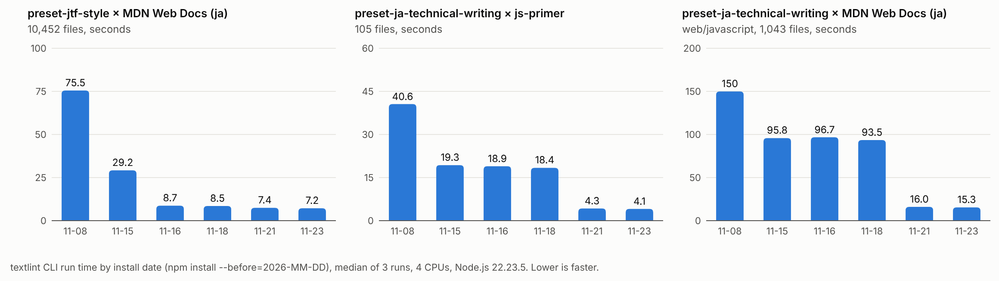

この2週間で、[textlint](https://github.com/textlint/textlint)と、よく使われているルールやライブラリのパフォーマンスを改善しました。
lintにかかる時間は、約10分の1になっています。



グラフは、その日に`npm install`した状態での実行時間です。
設定やルールは変えずに、textlintとルールをアップデートすると速くなります。

```sh
npm install --save-dev textlint@latest
npm update
```

textlint v16はNode.js 22.12.0以降が必要です。
変更の一覧と計測方法は、textlintのブログに英語で書いています。

- [Performance improvements in textlint and its rules](https://textlint.org/blog/2026/11/23/textlint-performance/)

この記事では、なぜ今パフォーマンスを改善したのかと、どう進めたのかを書きます。

## なぜ今パフォーマンスなのか

textlintは、これまでパフォーマンスを目標に入れていませんでした。
textlintはルールをすべて外から追加するlinterで、ルールは辞書を読み込んだり、形態素解析をしたりと自由に書けます。
実行時間のほとんどはルールが使うので、速さよりも、ルールを自由に書けることを優先していました。

ただ、AIエージェントが書くものは、コードだけではなくドキュメントも増えています。
開発のライフサイクルの中で書かれる文章は、これからも増えていくと思っています。

ドキュメントが増えると、その分だけlintは遅くなります。
lintは、同じ文章には同じ結果を返す決定的な処理です。
編集のたびに実行して直すことを積み重ねるには、自然言語のlintにもある程度の速さが必要です。

## 互換性を保つ: Secretlintとの違い

textlintの前に、[Secretlint](https://github.com/secretlint/secretlint)のパフォーマンスを改善していました。

- [Secretlint v14.0.0リリース: 設定なしで動作するように変更、大規模リポジトリのチェックを高速化](https://efcl.info/2026/11/16/secretlint-v14/)

Secretlintは、ルールのパッケージは分かれていたものの、実質的には公式ルールがコアのルールでした。
そのため、公式ルールを本体に入れて、ルールの書き方ごと変えるような最適化ができました。

textlintには、コアのルールがありません。
ルールはすべてユーザーランドにあり、自分がメンテナンスしていないルールもたくさんあります。
最適化に振り切ると、既存のルールとの互換性を犠牲にする部分が出てきます。

textlintでは、次の条件で進めました。

- 既存のルールと設定がそのまま動き、同じ結果を返す
- ルールのAPIやTxtASTは、速くするためには変えない
- 同じ処理を何度もしている、使われないオブジェクトを作っている、といった無駄を減らす

Secretlintほどの最適化ではなく、既存のルールをそのまま速くする改善です。

## 計測してから直す

進め方はSecretlintと同じで、計測して、時間がかかっている場所を直します。

最初に、Secretlintと同じ`--profile`フラグを入れました（[#2206](https://github.com/textlint/textlint/pull/2206)）。
フェーズ、ルール、ファイルごとの時間を出力します。
Pull Requestごとにbaseとheadを比べるCIも入れて、small、medium、large、hugeの4つのサイズの文書で、lintの結果と実行時間の差を見られるようにしました。

計測すると、ファイル数とルールの種類によって、時間のかかる場所が大きく変わりました。
ファイル数が少ないときは本体の比率が高く、多いときはルールの比率が高くなります。
次の表は、本体だけ、またはルールだけをアップデートした場合の実行時間です。

| | `jtf-style`でMDN | `ja-technical-writing`でjs-primer |
| --- | ---: | ---: |
| textlint 15.8.0と、2026-11-08時点のルール | 75.5 s | 40.6 s |
| 本体だけ新しい（16.1.3） | 27.1 s | 35.4 s |
| ルールだけ新しい | 52.6 s | 6.13 s |
| どちらも新しい | 7.17 s | 4.10 s |

`preset-jtf-style`は正規表現でチェックする軽いルールが多く、本体の時間が大きな割合を占めていました。
`preset-ja-technical-writing`は形態素解析をするルールが多く、ほとんどの時間がルールとそのライブラリでした。
ルールがユーザーランドにある以上、本体の改善だけでは限界があります。

そのため、先に本体を改善して、次にルールが共有しているライブラリを改善しました。

### 本体

本体では、Markdownパーサーを自前のものに書き直し、ルールを呼び出すときのノードごとの処理を減らしました。
ほかに、フォーマッター、起動時間、ファイルの読み込み方、GC、`--fix`を直しています。

GCは、コードを読んでもわからず、計測してわかった原因でした（[#2227](https://github.com/textlint/textlint/pull/2227)）。
コンストラクタの中でプロパティに代入した関数は、V8のold領域に確保されます。
ルールのコンテキストはルールとファイルごとに作るので、この関数が次のメジャーGCまで各ファイルのASTを生かし続けていました。

### ルール

文を分割する[sentence-splitter](https://github.com/textlint-rule/sentence-splitter)は、5.1.0でパーサーを書き直しました。
`preset-jtf-style`は3.1.0で、正規表現を毎回作り直すといった無駄を減らしています。

一番大きかったのは、形態素解析をする[kuromojin](https://github.com/textlint/kuromojin)です。
`preset-ja-technical-writing`では、実行時間の約70%が形態素解析でした。
kuromojin 3.1.0では、kuromoji.jsを使うのをやめて、自前の解析器と辞書ファイルに変えています。
トークンはkuromoji.jsと互換性があります。

kuromojinでは、先にプロトタイプを何パターンか書いて、どこまで削れるのかを見ました。
最初のプロトタイプで60%ぐらい削れたので、「今の時間を80%削る」を目標にしています。

実装する前には、仕様書を書きました。
textlintやSecretlintの開発でも使っている[sdev](https://github.com/azu/sdev)で、要件を定義して、デザインを起こしてから実装しています。
[解析器、辞書のフォーマット、辞書のバージョン](https://github.com/textlint/kuromojin/tree/master/docs/products/kuromojin)は、どれも仕様が先です。

辞書に単語を追加すると、形態素解析の結果が変わり、lintの結果も変わります。
そのため、メジャーバージョンの中では辞書を変えず、`dictionaryVersion`オプションで日付を指定したときだけ新しい辞書を使うようにしました。

## 複数のリポジトリをまたいで進める

textlintは、本体、ルール、ルールが使うライブラリを、別々のリポジトリで管理しています。
今回は、[textlint](https://github.com/textlint)、[textlint-ja](https://github.com/textlint-ja)、[textlint-rule](https://github.com/textlint-rule)などのリポジトリを、Claudeの1つのプロジェクトにまとめて進めました。


プロジェクトでは、調査や修正ごとにスレッドが分かれていて、別々のリポジトリの作業を並行して進められます。
あるスレッドでkuromojinの辞書の読み込みを直し、別のスレッドでそのkuromojinをtextlintのベンチマークで確かめる、といった進め方です。

計測も、基本的にはこのプロジェクトが動かしている[Claude Code on the web](https://code.claude.com/docs/en/claude-code-on-the-web)の環境でしています。
vCPUが4つの環境で、変更の前と後を同じ条件で測りながら直しました。
冒頭のグラフも、この環境で測ったものです。

多くのルールの土台になるリポジトリには、それぞれ計測の仕組みを入れています。

- textlint本体（Markdownパーサーを含む）: `--profile`と、CIでの比較
- kuromojin（解析器と辞書の読み込み）: `pnpm run profile`と、CIでの比較
- sentence-splitter: ベンチマークのスクリプト

リポジトリをローカルにチェックアウトしなくてよく、ローカルの権限も渡さなくてよいので、分かれたリポジトリをまとめて触る作業に向いていました。
kuromojinを使っているtextlint-jaのルールでは、npmへの公開を[OIDCを使ったフロー](https://efcl.info/2025/09/07/npm-oidc/)にそろえる作業も、同じプロジェクトでまとめてしています。

## 今考えていること

### スケール

今のtextlintは、1つのスレッドでファイルを1つずつlintしています。
もっと多くのファイルを扱うには、並列処理のような根本的な対応が必要になりそうです。

ただ、ルールを外から追加できるlinterでは、これが難しいです。
ファイルをまたいで状態を持つルールがあると、ファイルごとに分けて処理できません。
スレッドごとにルールと辞書を読み込み直すコストもあります。
どうするのが最適なのかは、まだよくわかっていません。

### 方向性を示すルール

AIが書いた文章には、特有の言い回しがあります。
禁止語のリストとしてルールにはできますが、ブラックリストは抜け道が多く、限界があります。

自分が書いてきたルールは、構造としてはっきりした方向性に沿わせるものが多いです。
1文の長さ、読点の数、同じ助詞の連続といったルールは、特定の単語を禁止するのではなく、ガードレールに近いものです。
この考え方は、まだうまく伝えられていません。

### アウトラインと本文

textlintが扱ってきたのは、単語、フレーズ、文といった本文の細かい部分です。
文章の良し悪しは、誰に何を伝えるのか、どの話題を選んで何を書かないのかといった、本文より手前で決まる部分が大きいです。

一人で書いていたときは、なぜこの順番にしたのか、何をあえて書かなかったのかを、自分が覚えていれば続きを書けました。
AIが構成を提案したり、本文を書き直したりするようになると、原稿に手を入れる主体は複数になります。
著者の頭の中にある判断を、次に手を入れる相手にどう渡すかが問題になります。

これは、目的を整理してから仕様やコードへ具体化する、sdevでやっていることに近いです。
textlintによる本文のチェックは、アウトラインと本文を見比べて直す往復の一部になります。
その仕組みがtextlint本体に入るものなのかは、まだわかりません。

## おわりに

文書の数が多くて遅いという場合は、`textlint --profile`の出力を[GitHub Discussions](https://github.com/textlint/textlint/discussions)で教えてください。

また、textlintの開発を支援してくれる方やスポンサーを募集しています。

- [Sponsor @azu on GitHub Sponsors](https://github.com/sponsors/azu)
