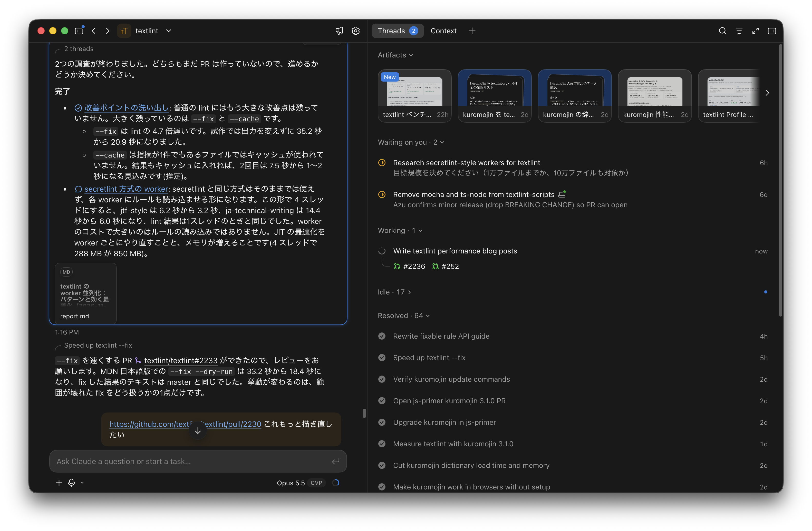

この2週間で、[textlint](https://github.com/textlint/textlint)と、よく使われているルールやライブラリのパフォーマンスを改善しました。
lintにかかる時間は、約10分の1になっています。


グラフは、その日に`npm install`した状態での実行時間です。
設定やルールは変えずに、textlintとルールをアップデートすると速くなります。

```sh
npm install --save-dev textlint@latest
npm update
```

textlint v16はNode.js 22.12.0以降が必要です。
変更の一覧と計測方法は、textlintのブログに英語で書いています。

- [Performance improvements in textlint and its rules](https://textlint.org/blog/2026/11/23/textlint-performance/)

この記事では、複数のリポジトリに分かれたtextlintの改善を、どう進めたのかを書きます。

## 背景

AIエージェントが書くものは、コードだけではなくドキュメントも増えています。
ドキュメントが増えると、その分だけlintは遅くなります。
編集のたびに実行して直すことを積み重ねるには、自然言語のlintにもある程度の速さが必要です。

一方で、textlintはこれまでパフォーマンスを目標に入れていませんでした。
ルールはすべて本体の外から追加するもので、辞書を読み込んだり、形態素解析をしたりと自由に書けます。
実行時間のほとんどはルールが使うので、速さよりも、ルールを自由に書けることを優先していました。

先に改善した[Secretlint](https://efcl.info/2026/11/16/secretlint-v14/)は、公式ルールが実質的にコアのルールでした。
そのため、ルールの書き方ごと変えるような最適化ができました。
textlintのルールはすべてユーザーランドにあり、自分がメンテナンスしていないルールもたくさんあります。
ルールの書き方を変える最適化はできないので、次の条件で進めることにしました。

- 既存のルールと設定がそのまま動き、同じ結果を返す
- ルールのAPIやTxtASTは、速くするためには変えない
- 同じ処理を何度もしている、使われないオブジェクトを作っている、といった無駄を減らす

この条件だと、本体だけを直しても足りません。
本体、ルール、ルールが使うライブラリは別々のリポジトリにあり、本体を変えたときにルールの結果が変わらないかも確かめる必要があります。

## Claude Projectsでどう進めたか

まず、本体とルールのリポジトリを1つのプロジェクトにまとめました。
[textlint](https://github.com/textlint)、[textlint-ja](https://github.com/textlint-ja)、[textlint-rule](https://github.com/textlint-rule)などのリポジトリを、[Claude Projects](https://support.claude.com/en/articles/9517075-what-are-projects)の1つのプロジェクトで扱っています。



その中で、次の2つをしながら改善を進めました。

- 本体の変更がルールの結果に影響していないかを見る、互換性のチェック
- 本体とルールの全体を通したプロファイル

プロジェクトでは、調査や修正ごとにスレッドが分かれていて、別々のリポジトリの作業を並行して進められます。
あるスレッドでkuromojinの辞書の読み込みを直し、別のスレッドでそのkuromojinをtextlintのベンチマークで確かめる、といった進め方です。
あるスレッドで計測した結果は、別のスレッドがコンテキストとして使えます。
そのため、計測して、直して、また計測するという繰り返しを、リポジトリをまたいで続けられました。

やることがほぼ決まっている作業はOpus、検討が必要なものはFable、というようにモデルも使い分けていました。
リポジトリをローカルにチェックアウトしなくてよく、ローカルの権限も渡さなくてよいので、分かれたリポジトリをまとめて触る作業に向いていました。
kuromojinを使っているtextlint-jaのルールでは、npmへの公開を[OIDCを使ったフロー](https://efcl.info/2025/09/07/npm-oidc/)にそろえる作業も、同じプロジェクトでまとめてしています。

### 計測

計測は、このプロジェクトが動かしている[Claude Code on the web](https://code.claude.com/docs/en/claude-code-on-the-web)の環境でしています。
vCPUが4つの環境で、変更の前と後を同じ条件で測りながら直しました。
冒頭のグラフも、この環境で測ったものです。

最初に、Secretlintと同じ`--profile`フラグを入れました（[#2206](https://github.com/textlint/textlint/pull/2206)）。
フェーズ、ルール、ファイルごとの時間を出力します。
Pull Requestごとにbaseとheadを比べるCIも入れて、lintの結果と実行時間の差を見られるようにしました。
kuromojinにも、同じようにプロファイルとCIでの比較を入れています。

互換性も、同じ方法で確かめています。
同じ文書を変更の前と後でlintして、結果が変わっていないかを比べます。
`preset-jtf-style`でMDNの日本語版をlintした結果は、アップデートの前後で177,741件すべてが同じでした。

最初に直したのは本体です。
Markdownパーサーや、ルールを呼び出すときのノードごとの処理を改善しました。

本体を直していくと、実行時間に占めるルールの割合が大きくなります。
わかってはいたことですが、プロファイルの結果をプロジェクトの中で図にして、実際の割合を確かめました。


約10万ファイルで測ると、正規表現のルールが1個だけならルールの割合は15%ですが、`preset-jtf-style`では63%でした。
形態素解析をするルールでは、ほとんどがルールの時間です。

そこから、どのルールとライブラリが時間を使っているのかを見て、割合の大きいものから直しました。

- `preset-jtf-style`は、ノードごとに正規表現を作り直していた
    - 3.1.0で、正規表現を1回だけ作るようにした
- `preset-ja-technical-writing`は、実行時間の約70%が形態素解析だった
    - 形態素解析をする[kuromojin](https://github.com/textlint/kuromojin)を、3.1.0で自前の解析器に変えた
- 文を分割する[sentence-splitter](https://github.com/textlint-rule/sentence-splitter)は、多くのルールが使っている
    - 5.1.0でパーサーを書き直した

次の表は、本体だけ、またはルールだけをアップデートした場合の実行時間です。

| | `jtf-style`でMDN | `ja-technical-writing`でjs-primer |
| --- | ---: | ---: |
| textlint 15.8.0と、2026-11-08時点のルール | 75.5 s | 40.6 s |
| 本体だけ新しい（16.1.3） | 27.1 s | 35.4 s |
| ルールだけ新しい | 52.6 s | 6.13 s |
| どちらも新しい | 7.17 s | 4.10 s |

軽いルールが多い`preset-jtf-style`は本体の改善が効き、形態素解析をする`preset-ja-technical-writing`はルールの改善が効いています。

コードを読んでもわからず、計測してわかった原因もあります（[#2227](https://github.com/textlint/textlint/pull/2227)）。
コンストラクタの中でプロパティに代入した関数は、V8のold領域に確保されます。
ルールのコンテキストはルールとファイルごとに作るので、この関数が次のメジャーGCまで各ファイルのASTを生かし続けていました。

### 調査

うまくいくかわからない調査は、スレッドを分けて投機的に投げています。
調査の結果を見て、ちゃんとやると決めたものだけを、仕様と実装に進めます。

kuromojinは、この流れで進めました。
先にプロトタイプを何パターンか書いて、どこまで削れるのかを見ています。
最初のプロトタイプで60%ぐらい削れたので、「今の時間を80%削る」を目標にしました。

### 仕様と実装

やると決めたものは、[sdev](https://github.com/azu/sdev)で要件を定義して、デザインを起こしてから、その仕様をもとに実装します。
kuromojinの[解析器、辞書のフォーマット、辞書のバージョン](https://github.com/textlint/kuromojin/tree/master/docs/products/kuromojin)は、どれも仕様が先です。

仕様を先に書くと、互換性に関わる判断を実装の前に決められます。
辞書に単語を追加すると、形態素解析の結果が変わり、lintの結果も変わります。
そのため、メジャーバージョンの中では辞書を変えず、`dictionaryVersion`オプションで日付を指定したときだけ新しい辞書を使う仕様にしました。

この仕様をもとに、kuromojin 3.1.0はkuromoji.jsを使うのをやめて、自前の解析器と辞書ファイルに変えています。
トークンはkuromoji.jsと互換性があります。
textlint本体のMarkdownパーサーも、同じように仕様を書いてから、自前のものに書き直しました（[#2188](https://github.com/textlint/textlint/pull/2188)）。

## 今後

### スケール

今のtextlintは、1つのスレッドでファイルを1つずつlintしています。
もっと多くのファイルを扱うには、並列処理のような根本的な対応が必要になりそうです。

ただ、ルールを外から追加できるlinterでは、これが難しいです。
ファイルをまたいで状態を持つルールがあると、ファイルごとに分けて処理できません。
スレッドごとにルールと辞書を読み込み直すコストもあります。
どうするのが最適なのかは、まだよくわかっていません。

### アウトラインと本文

textlintが扱ってきたのは、単語、フレーズ、文といった本文の細かい部分です。
文章の良し悪しは、誰に何を伝えるのか、どの話題を選んで何を書かないのかといった、本文より手前で決まる部分が大きいです。

一人で書いていたときは、なぜこの順番にしたのか、何をあえて書かなかったのかを、自分が覚えていれば続きを書けました。
AIが構成を提案したり、本文を書き直したりするようになると、原稿に手を入れる主体は複数になります。
著者の頭の中にある判断を、次に手を入れる相手にどう渡すかが問題になります。

これは、目的を整理してから仕様やコードへ具体化する、sdevでやっていることに近いです。
textlintによる本文のチェックは、アウトラインと本文を見比べて直す往復の一部になります。
その仕組みがtextlint本体に入るものなのかは、まだわかりません。

## おわりに

文書の数が多くて遅いという場合は、`textlint --profile`の出力を[GitHub Discussions](https://github.com/textlint/textlint/discussions)で教えてください。

また、textlintの開発を支援してくれる方やスポンサーを募集しています。

- [Sponsor @azu on GitHub Sponsors](https://github.com/sponsors/azu)
