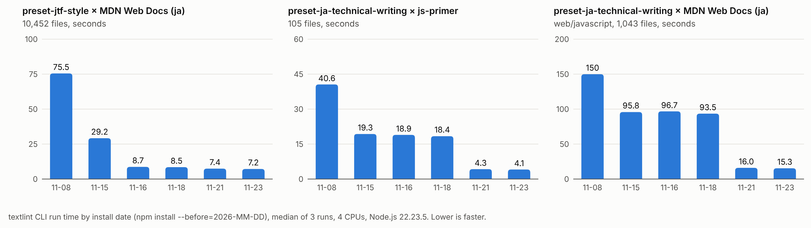
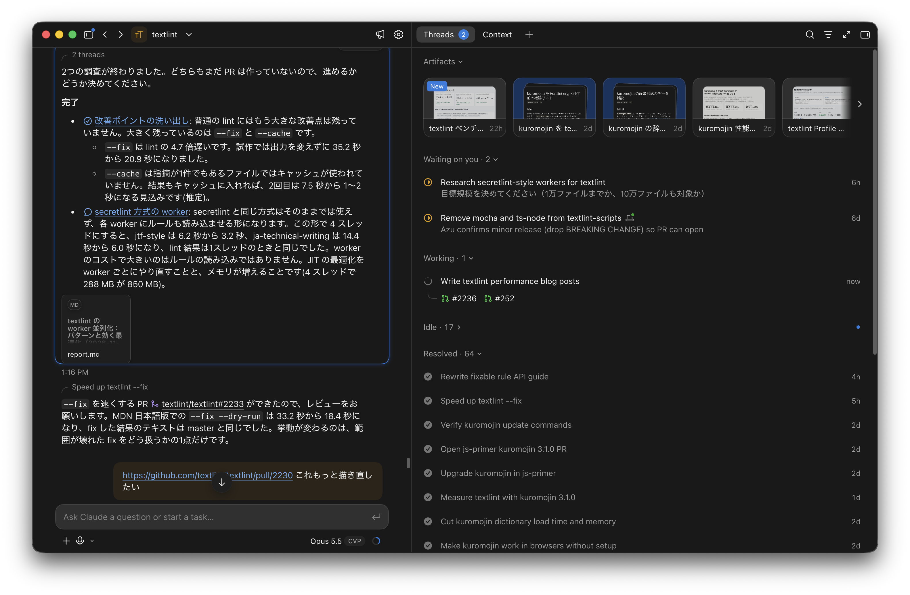
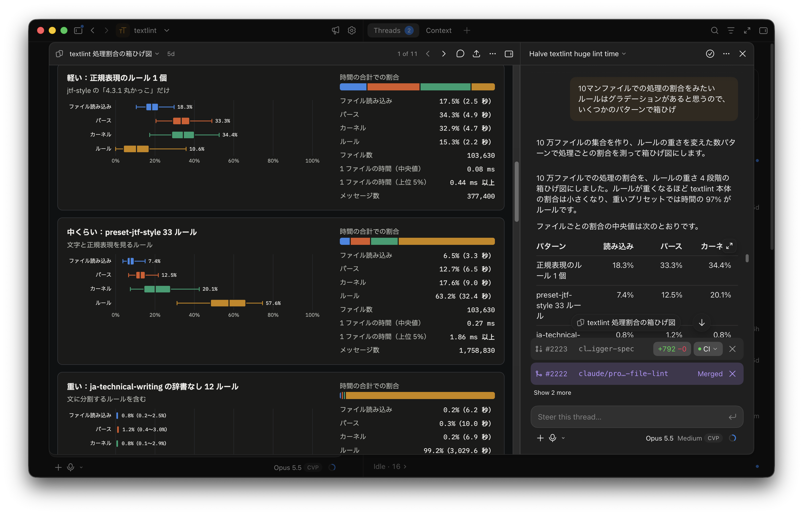
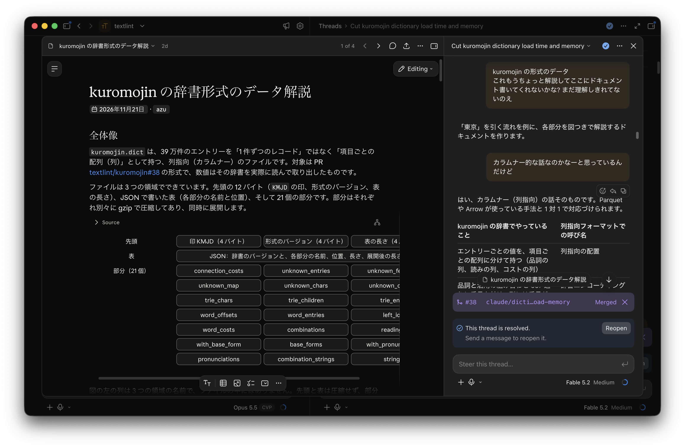

この2週間で、[textlint](https://github.com/textlint/textlint)と、よく使われているルールやライブラリのパフォーマンスを改善し、実行時間は約1/10になりました。



グラフは、その日に`npm install`したtextlintとルールでの実行時間です。
そのため、設定やルールは変えずに、textlintとルールをアップデートするだけで改善できます。

```sh
npm install --save-dev textlint@latest
npm update
```

textlint v16はNode.js 22.12.0以降が必要です。
詳細な改善内容は、textlintのブログに書いています。

- [Performance improvements in textlint and its rules](https://textlint.org/blog/2026/11/23/textlint-performance/)

この記事では、複数のリポジトリに分かれたtextlintの改善を、Claude Projectsを使ってどう進めたのかを書きます。

## 背景

AIエージェントが書くものは、コードだけではなくドキュメントも増えています。
ドキュメントが増えると、その分だけlintは遅くなります。
編集のたびに実行して直すことを積み重ねるには、自然言語のlintにもある程度の速さが必要です。

一方で、textlintはこれまでパフォーマンスを目標に入れていませんでした。
ルールはすべてtextlint本体の外から追加するもので、辞書を読み込んだり、形態素解析をしたりと自由に書けます。
自然言語は英語や日本語といった言語ごとに異なり、同じ日本語でも文体がかなり異なるので、コアに持つルールを決めるのが難しいためです。
実行時間のほとんどはルールが使うので、速さよりも、ルールを自由に書けることを優先していました。
これは次のスライドでも書いています。

- [textlint - Linterの作り方](https://azu.github.io/slide/2022/lint-night/textlint.html)
- [読む技術・書く技術・伝える技術 - 15年続けて分かった持続可能なオープンソース開発](https://azu.github.io/slide/2025/yapc/opensource-15years.html)

先に改善したSecretlintは、公式ルールが実質的にコアのルールでした。
そのため、ルールの書き方ごと変えるような最適化ができました。
これは次の記事で解説しています。

- [Secretlint v14.0.0リリース: 設定なしで動作するように変更、大規模リポジトリのチェックを高速化](https://efcl.info/2026/11/16/secretlint-v14/)

一方で、textlintのルールはすべてユーザーランドにあり、自分がメンテナンスしていないルールもたくさんあります。
ルールの書き方を変える最適化はできないので、次の条件で進めることにしました。

- 既存のルールと設定がそのまま動き、同じ結果を返す
- ルールのAPIやTxtASTは、速くするためには変えない
- 同じ処理を何度もしている、使われないオブジェクトを作っている、といった無駄を減らす

この条件だと、textlint本体だけを直しても足りません。
textlint本体、ルール、ルールが使うライブラリは別々のリポジトリにあるため、textlint本体を変えたときにルールの結果が変わらないかも確かめる必要があります。

## Claude Projectsでどう進めたか

まず、[textlint](https://github.com/textlint)、[textlint-ja](https://github.com/textlint-ja)、[textlint-rule](https://github.com/textlint-rule)などにあるtextlint本体とルールのリポジトリを、[Claude Projects](https://support.claude.com/en/articles/9517075-what-are-projects)の1つのプロジェクトにまとめました。
これによって、textlint本体とルールをまとめて扱えます。
Claude Projectsでは、最初にプロジェクトへ入れるリポジトリを選びますが、それ以外のリポジトリもスレッドの中でアドホックに追加できるのが良いところです。
この2週間でPull Requestを出したリポジトリは、合わせて30以上ありました。

[](/wp-content/uploads/2026/textlint-performance-claude-project.png)

このプロジェクトで、主に次の2点をチェックしながら改善を進めました。

- textlint本体の変更がルールの結果に影響していないかを見る、互換性のチェック
- textlint本体とルールの全体を通した、End to Endなプロファイル

プロジェクトでは、調査や修正ごとにスレッドが分かれていて、別々のリポジトリの作業を並行して進められます。
あるスレッドで[kuromojin](https://github.com/textlint/kuromojin)の辞書の読み込みを直し、別のスレッドでそのkuromojinをtextlintのベンチマークで確かめる、といった進め方です。
あるスレッドで計測した結果は、別のスレッドがコンテキストとして使えます。
そのため、計測して、直して、また計測するという繰り返しを、リポジトリをまたいで続けられました。

やることがほぼ決まっている作業はOpus、探索が必要なものはFable、というようにモデルも使い分けていました。
リポジトリをローカルにチェックアウトしなくてよく、ローカルの権限も渡さなくてよいので、分かれたリポジトリをまとめて触る作業に向いていました。
kuromojinを使っているtextlint-jaのルールでは、npmへの公開を[OIDCを使ったフロー](https://efcl.info/2025/09/07/npm-oidc/)にそろえる作業も、同じプロジェクトでまとめてしています。

### 計測

計測は主に、Claude Projectsが動かしている[Claude Code on the web](https://code.claude.com/docs/en/claude-code-on-the-web)の環境でしています。
vCPUが4つの環境で、変更の前と後を同じ条件で測りながら直しました。
冒頭のグラフも、この環境で測ったものです。
この環境だけではなく、Pull RequestごとのCIでも比べています。
CPUのコア数が重要になるケースなどは、ローカルでも計測しています。

最初に、`textlint` CLIに`--profile`フラグを入れました（[#2206](https://github.com/textlint/textlint/pull/2206)）。
設定の読み込み、ファイルの検索、パース、ASTの走査、ルールの実行といった処理ごとの時間と、ルールごと、ファイルごとの時間を出力します。
Pull Requestごとにbaseとheadを比べるCIも入れて、lintの結果と実行時間の差を見られるようにしました。
kuromojinにも、同じようにプロファイルとCIでの比較を入れています。

互換性も、同じ方法で確かめています。
同じ文書を変更の前と後でlintして、結果が変わっていないかを比べます。
例えば、`preset-jtf-style`を改善していった際には、約1万ファイルあるMDNの日本語版をlintして、変更の前後で結果が同じことを確かめています。

最初に直したのはtextlint本体です。
Markdownパーサーや、ルールを呼び出すときのノード（TxtASTのノード）ごとの処理を改善しました。

textlint本体を直していくと、実行時間に占めるルールの割合が大きくなります。
プロファイルの結果をプロジェクトの中で可視化しながら、次に何を改善していくかを決めていきました。

[](/wp-content/uploads/2026/textlint-performance-phase-share.png)

MDNの日本語版を10回繰り返した約10万ファイルで測ると、正規表現のルールが1個だけならルールの割合は15%ですが、`preset-jtf-style`では63%でした。
`preset-ja-technical-writing`では、ほとんどがルールの時間です。

そこから、どのルールとライブラリが時間を使っているのかを見て、割合の大きいものから直しました。

- [preset-jtf-style](https://github.com/textlint-ja/textlint-rule-preset-JTF-style)は、ノードごとに正規表現を作り直していた
    - 3.1.0で、正規表現を1回だけ作るようにした
- [preset-ja-technical-writing](https://github.com/textlint-ja/textlint-rule-preset-ja-technical-writing)は、実行時間の約70%が形態素解析だった
    - 形態素解析をするkuromojinを、[3.1.0](https://github.com/textlint/kuromojin/releases/tag/v3.1.0)で自前の解析器に変えた
- 文を分割する[sentence-splitter](https://github.com/textlint-rule/sentence-splitter)は、多くのルールが使っている
    - 5.1.0でパーサーを書き直した

次の表は、textlint本体だけ、またはルールだけをアップデートした場合の実行時間です。

| | `jtf-style`でMDN | `ja-technical-writing`でjs-primer |
| --- | ---: | ---: |
| textlint 15.8.0と、2026-11-08時点のルール | 75.5 s | 40.6 s |
| textlint本体だけ新しい（16.1.3） | 27.1 s | 35.4 s |
| ルールだけ新しい | 52.6 s | 6.13 s |
| どちらも新しい | 7.17 s | 4.10 s |

軽いルールが多い`preset-jtf-style`ではtextlint本体の改善が有効で、形態素解析をする`preset-ja-technical-writing`ではルールの改善が有効でした。

プロファイルをとってわかった問題もあります。
例えば、Garbage Collectionの時間が長くなっていた問題は、コードを見てもあまりわかりませんでした。
そこで、CPUプロファイルをとりながら、どこで問題が起きているのかを調査していきました。
そうすると、コンストラクタの中でプロパティに代入した関数が、V8の[Old Generation](https://v8.dev/blog/trash-talk)に確保されていることがわかりました。
ルールのコンテキストはルールとファイルごとに作るので、この関数が次のMajor GCまで各ファイルのASTを参照し続けて、Minor GCの時間を長くしていました（[#2227](https://github.com/textlint/textlint/pull/2227)）。

### 調査

どれぐらいうまくいくのかわからない調査は、スレッドを分けて投機的に投げています。
調査の結果を見て大まかな方向性を決めてから、仕様と実装に進めます。

kuromojinは、この流れで進めました。
textlintのルールの中でkuromojin（形態素解析）の処理の割合が高いことはわかっていたので、これをどう改善するかのプロトタイプを何パターンか書いて、どこまで削れるのかを見ました。

[](/wp-content/uploads/2026/textlint-performance-kuromojin-research.png)

最初のプロトタイプで実行時間の60%ぐらいは削れていて、形態素解析のコストを0にした場合の時間も測って、削れる上限を先に出しました。
そして、大まかな目標値として80%削ることを設定して進めていきました。

### 仕様と実装

方向性を決めたものは、[sdev](https://github.com/azu/sdev)で要件を定義して、デザインを起こしてから、その仕様をもとに実装します。
kuromojinの[解析器、辞書のフォーマット、辞書のバージョン](https://github.com/textlint/kuromojin/tree/master/docs/products/kuromojin)は、どれも仕様が先です。

仕様を読んでも理解しきれない部分は、同じプロジェクトの中で、実際のデータを図にした解説を書いてもらって確かめています。
次の画面は、kuromojinの辞書のフォーマットを解説してもらったときのものです。

[](/wp-content/uploads/2026/textlint-performance-kuromojin-spec.png)

解説してもらって理解しつつ、[辞書のデザイン](https://github.com/textlint/kuromojin/blob/master/docs/products/kuromojin/features/dictionary/design.ja.md)にもそれを反映していっています。

仕様を先に書くと、互換性に関わる判断を実装の前に決められます。
例えば、辞書に単語を追加すると、形態素解析の結果が変わり、lintの結果も変わります。
そのため、メジャーバージョンの中では辞書を変えず、`dictionaryVersion`オプションで日付を指定したときだけ新しい辞書を使う[仕様](https://github.com/textlint/kuromojin/blob/master/docs/products/kuromojin/features/dictionary-versions/requirements.ja.md)にしました。

これらの仕様をもとに、[kuromojin 3.1.0](https://github.com/textlint/kuromojin/releases/tag/v3.1.0)は[kuromoji.js](https://github.com/takuyaa/kuromoji.js)の処理を含む形にして、自前の解析器と辞書ファイルに変えています。
トークンはkuromoji.jsと互換性があります。

textlint本体のMarkdownパーサーも、自前のものに書き直しました（[#2188](https://github.com/textlint/textlint/pull/2188)）。
こちらは、実装と仕様を行き来しながら書いています（[#2192](https://github.com/textlint/textlint/pull/2192)）。
sdevの[既存コードのあるプロジェクトで仕様を起点にした開発を始める](https://github.com/azu/sdev/blob/df49074960f9bbba4bf2a2ff3355851e4de188f5/docs/guidelines/brownfield.ja.md)手順をベースにして、すでにある実装をドキュメントにしていきました。
コードに残っていない部分は、ドキュメントを見ながら意思決定しています。
その途中で、意図していなかった仕様も出てきました。
ノードの名前のように曖昧に決まっていた部分は、ドキュメントとして定義していきました。
[新しいMarkdownパーサー](https://textlint.org/blog/2026/11/15/textlint-16#new-markdown-parser)には一部Breaking Changeもありますが、これも実際に影響があるのかをスレッドで調査しながら固めていきました。

## 今後

### スケール

今のtextlintは、CPUのコアを1つだけ使ってファイルをlintしています。
もっと多くのファイルを扱うには、並列処理のような根本的な対応が必要になりそうです。

ただ、ルールを外から追加できるlinterでは、これが難しいです。
ルールはWorkerの中で動かす必要があるため、WorkerごとにJITの最適化をやり直すコストがあり、メモリも増えます。
どうするのが最適なのかは、まだよくわかっていません。

### アウトラインと本文

textlintが扱ってきたのは、単語、フレーズ、文といった本文の細かい部分です。
文章の良し悪しは、誰に何を伝えるのか、どの話題を選んで何を書かないのかといった、本文より手前で決まる部分が大きいです。

一人で書いていたときは、なぜこの順番にしたのか、何をあえて書かなかったのかを、自分が覚えていれば続きを書けました。
AIが構成を提案したり、本文を書き直したりするようになると、原稿に手を入れる主体は複数になります。
著者の頭の中にある判断を、次に手を入れる相手にどう渡すかが問題になります。

textlintによる本文のチェックは、アウトラインと本文を行き来して直す作業の一部です。
本文より手前の部分をtextlintで扱うのかは、まだわかりません。

## おわりに

文書の数が多くて遅いという場合は、`textlint --profile`の出力を[GitHub Discussions](https://github.com/textlint/textlint/discussions)で教えてください。

また、textlintの開発を支援してくれる方やスポンサーを募集しています。

- [Sponsor @azu on GitHub Sponsors](https://github.com/sponsors/azu)
